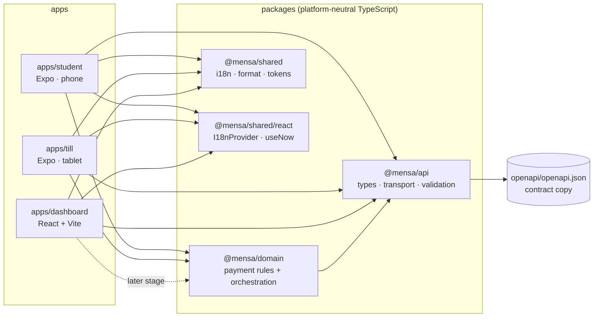
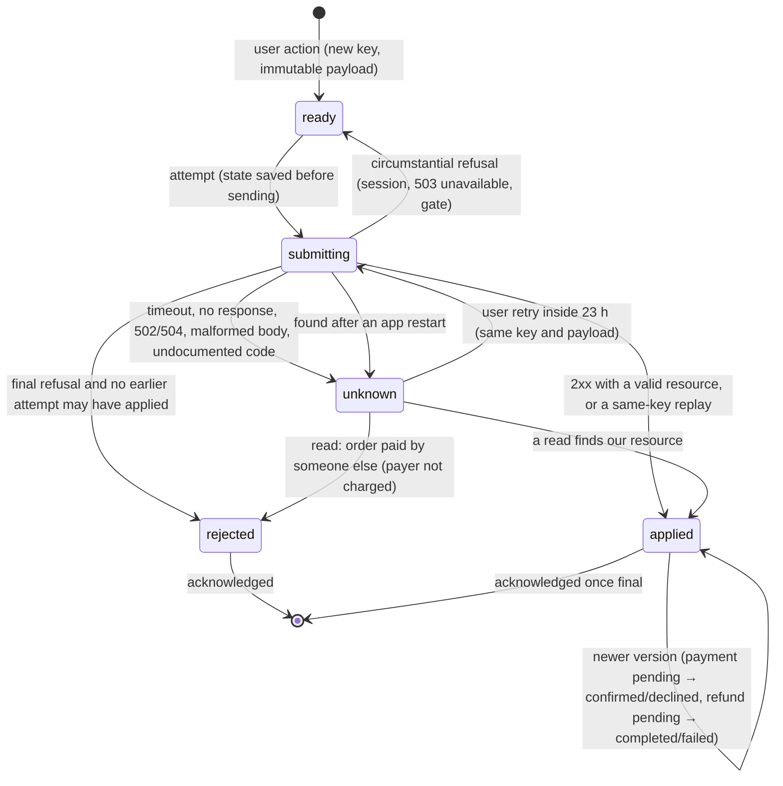

# Architecture (stage 2)

## Packages and dependency direction



- **`@mensa/api`**: generated contract types (`src/generated/openapi.ts`, never edited by hand),
  readable aliases (`src/types.ts`), the transport (`src/transport.ts`), runtime decoders
  (`src/decode.ts`, `src/schemas.ts`) and the typed client for all ten operations (`src/client.ts`).
- **`@mensa/domain`**: the payment rules and their orchestration: intents, their storage contract,
  write classification, sessions, server clock, gates, version reconciliation and polling. No UI and
  no platform APIs; storage, key generation and timers are injected.
- **`@mensa/shared`**: UI-independent helpers: DE/EN catalogues and `translate`, euro-cent and
  Europe/Berlin formatting, design tokens and the Tailwind preset. `@mensa/shared/react` is a separate
  entry point for React bindings, so scripts and `domain` never pull React in.

Packages export TypeScript source directly (`"exports": { ".": "./src/index.ts" }`). There is no
build step: Metro, Vite, `tsc` and `tsx` all resolve and compile the source. The dashboard declares
`@mensa/domain` but does not import it yet.

## How the platform boundary is enforced

1. **ESLint** (`eslint.config.mjs`): `packages/*/src` may not import `react-native`, `expo*`,
   `nativewind`, `react-dom` or `node:*`, nor use `process`, `window`, `document`, `navigator`,
   `localStorage`, `Buffer` or `require`. App and package source may not use `console`. Node-only
   tools live outside `src` (`packages/*/scripts`).
2. **Per-app typechecks** compile the imported package source under each app's own settings (React
   Native types for the Expo apps, DOM types for the dashboard).
3. **pnpm's isolated layout**: a package can only import what it declares. NativeWind relies on
   hoisting in two places, so both native apps declare two extra packages, pinned to the versions
   already in the tree:
   - `react-native-css-interop` (0.2.7): NativeWind's Babel transform writes imports of
     `react-native-css-interop/jsx-runtime` into app code.
   - `@babel/plugin-transform-react-jsx` (7.29.7, dev): css-interop's Babel preset names this plugin
     without declaring it. Dev bundles and `expo export` still found it through pnpm's hidden hoist
     folder, but the release bundling inside Gradle (`expo export:embed`) failed with
     "Cannot find module '@babel/plugin-transform-react-jsx'" until the app declared it.
4. **Single instances**: `react@19.1.0`, `react-native@0.81.5` and `react-native-css-interop@0.2.7`
   each exist once in the store (checked after install). `expo-doctor` (18/18) found no duplicate
   native modules. Each app sets `experiments.autolinkingModuleResolution`, as Expo recommends for
   monorepos on SDK 54.
5. **Test doubles stay out of app bundles**: the simulated server, the test harness and the in-memory
   intent store live in `packages/domain/src/testing/` and are not exported from the package. A scan
   of all four Hermes bundles found none of them.

## A request

```
.env → parsePublicApiConfig → createTransport → createApiClient → client.createPayment(token, orderId, body, key)
                                    │                    │
                       Date header → ServerClock         └ decoder: 2xx body → validated Payment, or invalid_response
                                                                        ↓
domain ← TransportResult: success | problem | invalid_response | no_response
```

The transport (`packages/api/src/transport.ts`) reports **facts**, never interpretations:

- it adds `X-Candidate-Id` to every request; `Authorization: Bearer …`, `Idempotency-Key` and
  `X-App-Version` only when given;
- it bounds each attempt with an `AbortController` timeout that also covers reading the body;
- it parses `application/problem+json` into a `Problem`, and reports a non-JSON body
  (`unparsable_body`) or a non-problem error body such as a proxy's HTML page
  (`unexpected_error_body`) as `invalid_response`;
- it reports every valid `Date` header to `onServerDate`, and reads `Idempotent-Replayed`;
- it **never retries and never logs.**

The client (`packages/api/src/client.ts`) validates every 2xx body against a decoder typed by the
generated contract types. An empty or malformed 2xx body becomes `invalid_response` with reason
`invalid_resource`, never a resource. Decoders keep role-specific optional and nullable fields, treat
money as integer cents (zero refundable is valid; report net totals may be negative) and treat the
access token as an opaque non-empty string. Write methods require a branded `IdempotencyKey`
(1–255 visible ASCII characters, checked by `toIdempotencyKey`); sessions take none.

Interpretation happens in the domain. `classifyWrite` (`packages/domain/src/write-outcome.ts`) turns
one attempt into `applied`, `refused` (final or not), `ambiguous` or `discarded`, by **documented
Problem code**, not by HTTP status or `retryable`. Timeouts, dropped connections, 502/504,
`idempotency_mismatch`, malformed bodies and undocumented codes are `ambiguous`: maybe applied.

## Payment domain

### Where each responsibility lives

| Responsibility                                   | Module (`packages/domain/src/`)             |
| ------------------------------------------------ | ------------------------------------------- |
| Intent records and their pure transitions        | `intent.ts`                                 |
| Starting, persisting, sending, settling, reading | `intent-controller.ts` (`IntentController`) |
| Storage contract, record size and validation     | `intent-store.ts` (`IntentStore`)           |
| What one write attempt proves                    | `write-outcome.ts` (`classifyWrite`)        |
| Bearer token, re-login, account switches         | `session.ts` (`SessionCoordinator`)         |
| Server time from `Date` headers                  | `server-clock.ts` (`ServerClock`)           |
| Minimum version and payments switch              | `payment-gate.ts`, `app-version.ts`         |
| Newest copy of orders and payments               | `resource-cache.ts`, `versioning.ts`        |
| Bounded, pausable polling                        | `poller.ts`                                 |
| Till QR → order ID                               | `qr.ts` (`parseOrderQr`)                    |
| SecureStore adapter, native wiring (each app)    | `apps/*/src/payments/`                      |

### The life of an intent

An intent is one deliberate action: ring up an order (cashier), pay an order (payer) or refund a
payment (cashier). `IntentController` runs one per signed-in user:

1. **Start.** `payOrder`, `createOrder` or `refund` checks the role and the payload, then looks for
   an intent on the same target (`order:<id>`, `payment:<id>`, `till-order`). A repeated tap gets the
   existing intent back, with no new key and no new request. A different payload on an unresolved
   target is a `conflict`. After a known final result, only a call that names that result
   (`afterFinalKey`) starts a new action, so a new key always means a deliberate new action.
2. **Checks.** Payments refresh the gate (`GET /config`) first; refunds read `GET /payments/{id}` and
   compare with the server's `refundableAmountCents`, which already subtracts pending refunds. Server
   time must be known (one `GET /config` if not).
3. **Save, then send.** The record is saved as `submitting` with its key and payload **before** the
   request leaves. If saving fails, nothing is sent (`storage_failed`).
4. **Settle.** The attempt's outcome is applied to the record as it is _now_ (a read may have settled
   it meanwhile), saved, and the intent is polled if reads can still teach something.
5. **Read until settled.** Polling reads never write. Only `retry(key)`, called for a user action,
   sends the same key and payload again, and only inside the replay window.

The controller never writes on its own: no offline queue, no resubmission on reconnect or restart.



`maybeApplied` is sticky: once an attempt may have reached the server, a later refusal (a 401, a
503, even `order_already_paid`) keeps the intent `unknown` instead of `rejected`, because it could be
hiding our own earlier success. Only the server's resource settles it.

Server states stay separate from these client states:

| Resource | Server states                       | Means success only when |
| -------- | ----------------------------------- | ----------------------- |
| Order    | `open`, `paying`, `paid`, `expired` | `paid`                  |
| Payment  | `pending`, `confirmed`, `declined`  | `confirmed`             |
| Refund   | `pending`, `completed`, `failed`    | `completed`             |

`paymentDisplay` maps a payment intent to what a payer may be told: `not_sent`, `sending`,
`checking` (unknown), `pending`, `confirmed`, `declined` or `refused`. No timeout, polling deadline or
order countdown turns `pending` or `checking` into `declined`.

### Recovering an unknown outcome

| Intent           | How the outcome is found                                                                                                                                                                                                                                                                                                               |
| ---------------- | -------------------------------------------------------------------------------------------------------------------------------------------------------------------------------------------------------------------------------------------------------------------------------------------------------------------------------------- |
| Pay an order     | 1. `GET /orders/{id}`: a payer sees only their own `paymentId`; read it and check it. 2. `GET /payments?q=<orderId>`: `q` is a prefix search, so each hit must match the exact order, payer and amount, and must not belong to another intent. 3. Order `paid` with no visible payment: someone else paid; this payer was not charged. |
| Ring up an order | No read path (there is no order list): only a same-key replay inside the retention window.                                                                                                                                                                                                                                             |
| Refund           | No read path: refunds are recognised by ID only, because two refunds can share amount, reason and time. Only a same-key replay inside the retention window.                                                                                                                                                                            |

Replays are allowed while less than 23 hours of **server time** have passed since the first attempt
(`REPLAY_WINDOW_MS`, one hour inside the documented 24-hour key retention). Beyond that, or while
server time is unknown, the intent is only read. If reads cannot settle it, it stays unknown and is
shown as such: the client relies on the server's guarantees (idempotent replay inside the
retention, one non-declined payment per order, payers see their own payment ID) and states that.

### Versions and details

Every order and payment copy (write response, poll, list item, detail) goes through `ResourceCache`:
a lower version never replaces a higher one. Payment details are kept as a separate projection:
a list item and a detail with the same version describe the same state, but only the detail has
refunds and history, so a detail is shown only while it is at least as new as the newest summary.

One exception, observed on the live API: an order turns from `open` to `expired` without a new
version. `isLaterOrderState` accepts exactly that change at an equal version and nothing else; the
cache and the intent use the same rule, so a stale `open` read cannot undo an expiry even after a
restart. Refunds carry no version; a finished refund never moves back to `pending`.

### Sessions

`SessionCoordinator` holds the bearer token in memory only (never persisted, never logged):

- on `401 session_expired` it logs the **same seeded account** in again (bounded: two attempts) and
  repeats the call once with the same closure, so the same key and payload. Concurrent expiries
  share one re-login;
- the re-login must return the same server user ID, or nothing continues (`account_mismatch`);
- every sign-in and sign-out starts a new generation. A request or re-login from an earlier
  generation reports `account_changed`, its result is discarded, and the previous user's controller
  is disposed, so a late response can never update or show another user's state. The discarded
  attempt stays saved as "maybe sent" in its owner's partition and is read when that user returns.

Keeping the password in memory to log in again is specific to the seeded mock accounts: the API has
no refresh token. It is not a production authentication design.

### Server time

`ServerClock` estimates server time from `Date` headers plus a monotonic clock, as an interval: the
stamp was made between sending and receiving, and is truncated to whole seconds. Samples are
intersected; a contradicting sample replaces the estimate; returning to the foreground forgets it,
because monotonic clocks can pause while the device sleeps. Invalid calendar values are rejected.
The device clock is never read, so changing it has no effect. Replay age uses the safe bound (latest
now minus earliest first-attempt time); `expiryState` is a display hint that never decides a payment.

### Gates

`PaymentGate` reads `GET /config` at start-up, on every return to the foreground and before each new
payment or payment retry. It compares versions numerically (1.10.0 > 1.2.0) and fails closed: an
unparsable app or minimum version, or configuration that could not be read, blocks new payments. A
`426 app_version_unsupported` or `503 payments_disabled` after a passing pre-check blocks until the
next refresh. Reading and reconciling earlier payments is never gated. There is no update button: the
API provides no store URL. The gate concerns the payer app; the till does not show it.

### Intent records and storage

A record holds only what recovery needs, for example (values shortened):

```json
{
  "v": 1,
  "key": "8a1f…-uuid",
  "scope": { "candidateId": "c_…", "userId": "usr_…" },
  "state": "unknown",
  "attempts": 1,
  "maybeApplied": true,
  "firstSentAt": 1793438400123,
  "refusal": null,
  "kind": "payOrder",
  "payload": { "orderId": "ord_…", "amountCents": 500 },
  "resource": null
}
```

No token, password, display name or full server response is stored. Records are validated when read
back; one that does not validate is counted, never dropped, and while any record of the signed-in
user is unreadable the controller refuses every new action (it could be an unresolved intent for the
same action).

`apps/*/src/payments/secure-intent-store.ts` implements `IntentStore` with Expo SecureStore (iOS
Keychain; Android Keystore-encrypted storage), limits checked against the installed 15.0.8 source:

- keys `mensa.intents.v1.<scope>.index` (a JSON list of record keys) and
  `mensa.intents.v1.<scope>.r.<key>`; `scopeStorageId` escapes the scope into `[A-Za-z0-9._-]`
  without collisions;
- values ≤ 2048 bytes (`serializeIntent` refuses larger records before anything is sent); at most 32
  records per user, so the index stays small;
- `keychainAccessible: AFTER_FIRST_UNLOCK_THIS_DEVICE_ONLY`; the config plugin
  (`configureAndroidBackup`) excludes the data from Android backups, because a restored copy could
  not be decrypted on another device;
- operations on one scope run one after another; a record is written before the index lists it.

Settled intents are removed once their result has been acknowledged (`acknowledge`); the server
keeps the history.

### Native wiring

`apps/*/src/payments/PaymentServices.tsx` creates one `PaymentGate`, `SessionCoordinator` and
SecureStore-backed store per app process, and one `IntentController` per signed-in user (keyed by
user ID and role, so a 5-minute re-login keeps the controller). An `AppState` listener refreshes the
gate, forgets the server-time estimate and pauses or resumes polling. If the user's records cannot be
read, no controller is offered (`recordsUnavailable`). Keys come from `expo-crypto`'s `randomUUID`.
Nobody signs in yet, so in this stage no controller exists in the apps and nothing is written; the
student app shows the gate state, and both apps have a secure-storage self-check.

## Configuration

Each app reads two public values at build time: the API origin and the candidate ID. Expo inlines
only literal `process.env.EXPO_PUBLIC_*` reads (ESLint rejects destructuring and dynamic access), and
Vite inlines `import.meta.env.VITE_*`. Both end up readable in the shipped bundle. That was checked in
the Hermes bytecode, so they must never contain secrets. If a value is missing, the app shows which
variable is missing instead of crashing.

## Design tokens and accessibility

`packages/shared/src/tokens/tokens.json` is the single source. TypeScript reads it through
`src/tokens/index.ts`; the Tailwind preset (`tailwind-preset.cjs`) maps it to classes such as
`bg-brand`, `text-ink-muted`, `rounded-card` and `min-h-touch`, used by all three apps.

| Pair                                              | Contrast | Requirement             |
| ------------------------------------------------- | -------: | ----------------------- |
| ink `#111827` on surface `#FFFFFF`                |  17.74:1 | AA text 4.5:1           |
| ink-muted `#4B5563` on canvas `#F3F4F6`           |   6.87:1 | AA text                 |
| white on brand `#1D4ED8`                          |   6.70:1 | AA text                 |
| success `#15803D` on white                        |   5.02:1 | AA text                 |
| warning `#B45309` on white (and white on warning) |   5.02:1 | AA text                 |
| danger `#B91C1C` on white                         |   6.47:1 | AA text                 |
| line `#6B7280` on white                           |   4.83:1 | 3:1 for control borders |

Minimum touch target: 48 dp/px (`min-h-touch`), measured as 126 px = 48 dp on the 420 dpi emulator.
The language switch is a radio group (Android reports `RadioButton` with the checked state). Results
are announced: an Android live region, an explicit VoiceOver announcement on iOS, and `aria-live` on
the web. The payment gate card is a polite live region, so on Android a change (for example payments
paused) is announced; iOS has no live regions, and the gate card does not announce changes there yet.
The dashboard keeps `<html lang>` in sync with the chosen language.

## Internationalisation

English is the reference catalogue (`packages/shared/src/i18n/messages.ts`). The German catalogue
is typed as `Record<MessageKey, string>`, so a missing key fails the typecheck. The initial language
comes from `expo-localization` on native and `navigator.language` on the web. `Intl`'s default
locale was not reliable for this: in Expo Go on the iOS simulator it stayed English with the device
set to German. The user can switch at any time; the choice is not persisted yet.

## Native projects

The `android/` and `ios/` folders are generated by `expo prebuild` from `app.json` (Expo's
"Continuous Native Generation") and are git-ignored, so native configuration lives in one reviewable
file per app, including config plugins such as `expo-secure-store`'s. `scripts/build-android-apk.mjs`
regenerates `android/` and runs a release build with the JS bundle embedded.
