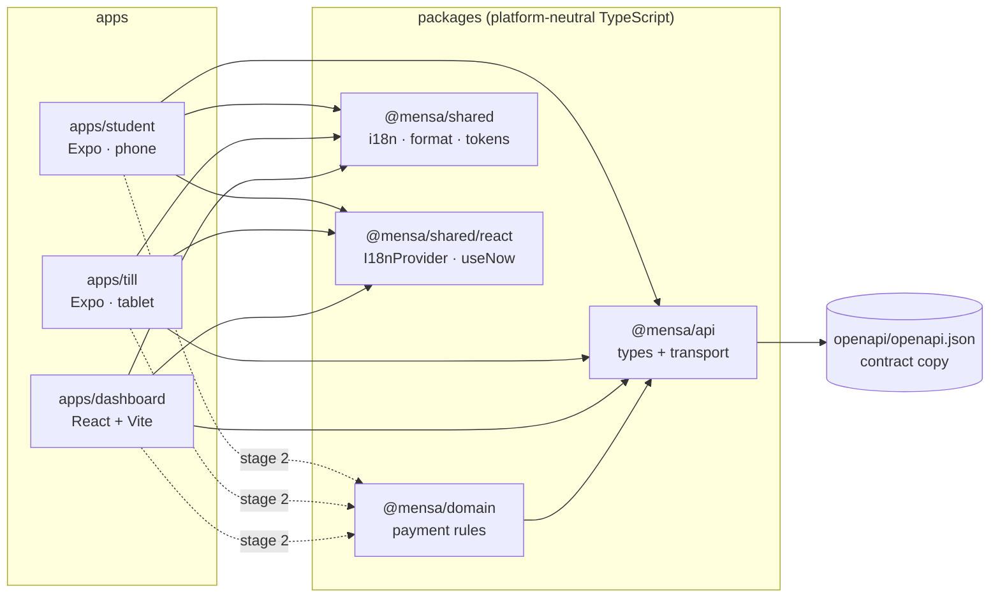

# Architecture (stage 1)

## Packages and dependency direction



- **`@mensa/api`**: generated contract types (`src/generated/openapi.ts`, never edited by hand),
  readable aliases (`src/types.ts`), the transport (`src/transport.ts`) and typed wrappers for the
  three endpoints the foundation uses (`src/client.ts`).
- **`@mensa/domain`**: where payment behaviour will live. Today it only holds `newerOf`, the rule
  that a lower `version` never replaces a higher one.
- **`@mensa/shared`**: UI-independent helpers: DE/EN catalogues and `translate`, euro-cent and
  Europe/Berlin formatting, design tokens and the Tailwind preset. `@mensa/shared/react` is a separate
  entry point for React bindings, so scripts and `domain` never pull React in.

Packages export TypeScript source directly (`"exports": { ".": "./src/index.ts" }`). There is no
build step: Metro, Vite, `tsc` and `tsx` all resolve and compile the source.

## How the platform boundary is enforced

1. **ESLint** (`eslint.config.mjs`): `packages/*/src` may not import `react-native`, `expo*`,
   `nativewind`, `react-dom` or `node:*`, nor use `process`, `window`, `document`, `navigator`,
   `localStorage`, `Buffer` or `require`. App and package source may not use `console`.
2. **Per-app typechecks** compile the imported package source under each app's own settings (React
   Native types for the Expo apps, DOM types for the dashboard).
3. **pnpm's isolated layout**: a package can only import what it declares. NativeWind relies on
   hoisting in two places, so both native apps declare two extra packages, pinned to the versions
   already in the tree:
   - `react-native-css-interop` (0.2.7): NativeWind's Babel transform writes imports of
     `react-native-css-interop/jsx-runtime` into app code.
   - `@babel/plugin-transform-react-jsx` (7.29.7, dev): css-interop's Babel preset names this plugin
     without declaring it. Dev bundles and `expo export` still found it through pnpm's hidden hoist
     folder, but the release bundling inside Gradle (`expo export:embed`) failed with
     "Cannot find module '@babel/plugin-transform-react-jsx'" until the app declared it.
4. **Single instances**: `react@19.1.0`, `react-native@0.81.5` and `react-native-css-interop@0.2.7`
   each exist once in the store (checked after install). `expo-doctor` (18/18) found no duplicate
   native modules. Each app sets `experiments.autolinkingModuleResolution`, as Expo recommends for
   monorepos on SDK 54.

## A request in stage 1

```
.env (EXPO_PUBLIC_* / VITE_*) → parsePublicApiConfig → createTransport → createApiClient → getConfig()
                                                                                  ↓
UI ← switch on TransportResult: success | problem | invalid_response | no_response
```

The transport (`packages/api/src/transport.ts`):

- adds `X-Candidate-Id` to every request; adds `Authorization: Bearer …`, `Idempotency-Key` and
  `X-App-Version` only when given;
- bounds each attempt with an `AbortController` timeout that also covers reading the body;
- parses `application/problem+json` into a typed `Problem`, and reports anything else that is not
  JSON as `invalid_response`;
- reads the server `Date` header (explicit RFC 9110 parser) and `Idempotent-Replayed`;
- **never retries and never logs.** Retrying a write without a persisted intent can move money twice,
  so retry policy belongs to the domain layer (stage 2). `no_response` and 502/504 after a POST
  mean "outcome unknown", not "failed".

Response bodies are trusted from the contract types and not validated at runtime yet (stage 2).

## Configuration

Each app reads two public values at build time: the API origin and the candidate ID. Expo inlines
only literal `process.env.EXPO_PUBLIC_*` reads (ESLint rejects destructuring and dynamic access), and
Vite inlines `import.meta.env.VITE_*`. Both end up readable in the shipped bundle. That was checked in
the Hermes bytecode, so they must never contain secrets. If a value is missing, the app shows which
variable is missing instead of crashing.

## Design tokens and accessibility

`packages/shared/src/tokens/tokens.json` is the single source. TypeScript reads it through
`src/tokens/index.ts`; the Tailwind preset (`tailwind-preset.cjs`) maps it to classes such as
`bg-brand`, `text-ink-muted`, `rounded-card` and `min-h-touch`, used by all three apps.

| Pair                                              | Contrast | Requirement             |
| ------------------------------------------------- | -------: | ----------------------- |
| ink `#111827` on surface `#FFFFFF`                |  17.74:1 | AA text 4.5:1           |
| ink-muted `#4B5563` on canvas `#F3F4F6`           |   6.87:1 | AA text                 |
| white on brand `#1D4ED8`                          |   6.70:1 | AA text                 |
| success `#15803D` on white                        |   5.02:1 | AA text                 |
| warning `#B45309` on white (and white on warning) |   5.02:1 | AA text                 |
| danger `#B91C1C` on white                         |   6.47:1 | AA text                 |
| line `#6B7280` on white                           |   4.83:1 | 3:1 for control borders |

Minimum touch target: 48 dp/px (`min-h-touch`), measured as 126 px = 48 dp on the 420 dpi emulator.
The language switch is a radio group (Android reports `RadioButton` with the checked state). Results
are announced: an Android live region, an explicit VoiceOver announcement on iOS, and `aria-live` on
the web. The dashboard keeps `<html lang>` in sync with the chosen language.

## Internationalisation

English is the reference catalogue (`packages/shared/src/i18n/messages.ts`). The German catalogue
is typed as `Record<MessageKey, string>`, so a missing key fails the typecheck. The initial language
comes from `expo-localization` on native and `navigator.language` on the web. `Intl`'s default
locale was not reliable for this: in Expo Go on the iOS simulator it stayed English with the device
set to German. The user can switch at any time; the choice is not persisted yet.

## Native projects

The `android/` and `ios/` folders are generated by `expo prebuild` from `app.json` (Expo's
"Continuous Native Generation") and are git-ignored, so native configuration lives in one reviewable
file per app. `scripts/build-android-apk.mjs` regenerates `android/` and runs a release build with
the JS bundle embedded.

## Planned payment design (not implemented)

Stage 2 is meant to add these to `@mensa/domain`. None of this exists yet:

- **Intent records** persisted on the device and scoped by candidate and user: one idempotency key
  plus the exact request body per order, payment or refund intent, reused for every retry.
- **Outcome classification**: confirmed / declined / pending / unknown. Unknown is resolved by
  retrying the same intent or by reading the resource, never by assuming failure.
- **Reconciliation**: every order/payment copy passes through `newerOf`, whether it comes from a
  mutation response, polling, a list or a detail.
- **Server clock**: an offset derived from `Date` headers decides expiry; the device clock does not.
- **Session handling**: re-login on `401 session_expired` that keeps the pending intent bound to
  the same user.
